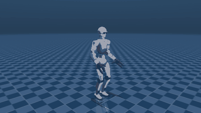
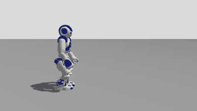

<h1 align="center"></h1>

<p align="center"><a href="https://github.com/juanscelyg/gaitos/actions/workflows/rolling.yml"></a></p>

ROS 2 framework for legged robots. One lifecycle node per robot runs a real-time cycle over
a shared robot state; the hardware, the motors, the sensors, the state estimator, the
controllers and the operation modes are pluginlib plugins selected and configured with ROS 2
parameters.

| | Go2 | R1 | NAO |
|---|:---:|:---:|:---:|
| **MuJoCo** | [](docs/tutorials/go2_mujoco.md) | [](docs/tutorials/r1_mujoco.md) | [](docs/tutorials/nao_mujoco.md) |
| **Gazebo** | [](docs/tutorials/go2_gazebo.md) | [](docs/tutorials/r1_gazebo.md) | [](docs/tutorials/nao_gazebo.md) |

- **Robots**: Unitree **Go2** (quadruped) and **R1** (humanoid; in MuJoCo also with its Dex3-1
  hands and stock colours, `model:=dex3`), plus the **NAO** (V6 motors)
  as a third robot added with its URDF, an SRDF and parameter files; it stands, walks and turns
  in MuJoCo and Gazebo.
- **Simulators**: **MuJoCo** (in the node, lockstep, publishes `/clock`) and **Gazebo**
  (gz-sim: a system plugin hosts the node, `ros_gz_sim` launch), plus the **unitree_sdk2 /
  DDS** path of the real robots.
- **ROS 2 native**: ament packages built with colcon, pluginlib, ROS 2 parameters
  (`robot_description`, `robot_description_semantic`), lifecycle node, topics, services, TF,
  `robot_state_publisher`, RViz, `joy`, `ros_gz_sim` / `ros_gz_bridge`, `osqp_vendor`.
- **Named poses in the SRDF** of each robot (`group_state`): the posture modes (stand up,
  stand down, sit, squat...) move between them.
- **Body relative commands**: `cmd_vel` (body twist) and `goal_pose` (the posture of the body
  while standing, a target to walk to while walking).
- **Kinematic and dynamic controllers**: gait with Raibert placement, ZMP / LIPM preview
  control for bipeds, convex MPC of the ground reaction forces for quadrupeds.
- **State estimation** with a Kalman filter of the base and the feet that also fuses
  **external odometries** (`nav_msgs/Odometry` topics, simulator ground truth, Unitree sport
  odometry).
- **Safety for the real robot**: dry run, joint limits, gain ramp, watchdog, remote with
  emergency stop.
- **Vendor interfaces in simulation**: the DDS interface of the Unitree robots and the ROS 2
  interface of naoqi_driver in front of the simulated robot, so programs written for the real
  robots run against MuJoCo and Gazebo unchanged.

## Quick start

```bash
mkdir -p ~/ws/legged_ws/src && cd ~/ws/legged_ws
git clone -b rolling https://github.com/juanscelyg/gaitos.git src/gaitos
source /opt/ros/rolling/setup.bash
sudo apt install libmujoco-dev libegl-dev ros-rolling-rmw-cyclonedds-cpp
rosdep install --from-paths src --ignore-src -y
colcon build --base-paths src --cmake-args -DCMAKE_BUILD_TYPE=Release
source install/setup.bash
ros2 launch gaitos_mujoco sim.launch.py robot:=go2
```

```bash
source ~/ws/legged_ws/install/setup.bash
ros2 service call /go2/mode/stand_up std_srvs/srv/Trigger
ros2 service call /go2/mode/balance_stand std_srvs/srv/Trigger
ros2 topic pub -r 10 /go2/cmd_vel geometry_msgs/msg/Twist "{linear: {x: 0.4}}"
ros2 service call /go2/mode/stand_down std_srvs/srv/Trigger
```

### More information

[Quick start, in detail](docs/quickstart.md): what each step does, Gazebo, the real Unitree
robots and their DDS simulator, the vendor interfaces in simulation and the display.

## Tutorials

Step by step, each robot in each simulator and the real robots: build, launch arguments,
modes, postures, walking, the vendor interfaces, known issues ([all the tutorials](docs/tutorials/README.md)).

| Robot | MuJoCo | Gazebo | Real robot |
|---|---|---|---|
| Go2 | [Go2 in MuJoCo](docs/tutorials/go2_mujoco.md) | [Go2 in Gazebo](docs/tutorials/go2_gazebo.md) | [Go2 real and DDS simulator](docs/tutorials/go2_real.md) |
| R1 | [R1 in MuJoCo](docs/tutorials/r1_mujoco.md) | [R1 in Gazebo](docs/tutorials/r1_gazebo.md) | [R1 real](docs/tutorials/r1_real.md) |
| NAO | [NAO in MuJoCo](docs/tutorials/nao_mujoco.md) | [NAO in Gazebo](docs/tutorials/nao_gazebo.md) | — |

## Documentation

| Page | Contents |
|---|---|
| [Build](docs/build.md) | Dependencies, FetchContent (SDK, messages, models), offline builds, CI. |
| [Quick start, in detail](docs/quickstart.md) | MuJoCo, Gazebo, the real Unitree robots, the DDS simulator, the display. |
| [Packages](docs/packages.md) | Every package of the repository and what it holds. |
| [Architecture and plugins](docs/architecture.md) | The real-time cycle, its stages, the plugin interfaces, writing a plugin. |
| [ROS 2 interfaces](docs/interfaces.md) | Topics, services, TF, the lifecycle node, node extensions. |
| [Operation modes](docs/modes.md) | Modes, their rules and the SRDF poses. |
| [Controllers and state estimation](docs/controllers.md) | Gait, stance, ZMP / LIPM, convex MPC, Kalman estimator, external odometry. |
| [Parameters](docs/parameters.md) | Parameter files, their order and blocks, gains. |
| [Vendor interfaces in simulation](docs/emulators.md) | Unitree DDS (R1, Go2) and naoqi_driver (NAO) in front of MuJoCo and Gazebo. |
| [Robots](docs/robots.md) | Go2, R1 and NAO: models, motors, contacts, backends; adding a robot. |
| [Safety and the real robot](docs/safety.md) | Read only, limits, gain ramp, watchdog, remote, a first-run sequence. |
| [Status](docs/status.md) | What is verified and the known limitations. |
| [Tutorials](docs/tutorials/README.md) | Each robot in each simulator and the real robots, step by step. |

## License

Apache 2.0. The robot models come from
[unitree_ros](https://github.com/unitreerobotics/unitree_ros) and
[unitree_mujoco](https://github.com/unitreerobotics/unitree_mujoco) (BSD-3-Clause, Unitree
Robotics) and [nao_robot](https://github.com/ros-naoqi/nao_robot) (BSD). The NAO meshes come
from the model "NAO with Ignition position controller" of [Gazebo Fuel](https://app.gazebosim.org/OpenRobotics/fuel/models/NAO%20with%20Ignition%20position%20controller) (OpenRobotics, CC BY 4.0).
