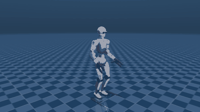
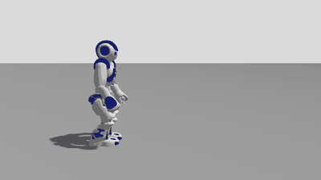

# gaitos tutorials

[← gaitos](../../README.md)

How to launch each robot in each simulator (and the real ones), step by step: build, launch
arguments, modes, postures, walking, the interfaces of the vendor (Unitree, naoqi_driver) in front
of the simulation, known issues and how the clips were made.

| Robot | MuJoCo | Gazebo | Real robot |
|---|---|---|---|
| **Go2** (Unitree quadruped) | [Go2 in MuJoCo](go2_mujoco.md): trot, convex MPC, postures, SportClient | [Go2 in Gazebo](go2_gazebo.md) | [Go2 real and DDS simulator](go2_real.md) |
| **R1** (Unitree humanoid) | [R1 in MuJoCo](r1_mujoco.md): ZMP / LIPM walking, postures, Dex3-1 hands, unitree_r1 | [R1 in Gazebo](r1_gazebo.md) | [R1 real](r1_real.md) |
| **NAO** (SoftBank / Aldebaran) | [NAO in MuJoCo](nao_mujoco.md) (with its meshes): walking, joints from outside, naoqi_driver | [NAO in Gazebo](nao_gazebo.md) (with its meshes) | — (no NAOqi / LoLA backend yet) |

| | | |
|:---:|:---:|:---:|
| [](go2_mujoco.md) | [](r1_mujoco.md) | [](nao_mujoco.md) |
| [](go2_gazebo.md) | [](r1_gazebo.md) | [](nao_gazebo.md) |

## Common to every tutorial

```bash
cd ~/ws/legged_ws
source /opt/ros/rolling/setup.bash
colcon build --base-paths src          # once (see docs/build.md)
source install/setup.bash
export ROS_DOMAIN_ID=<free domain>     # the emulated vendor interfaces use the robot topic names
```

- Each robot node is `gaitos` in the namespace of the robot (`/go2`, `/r1`, `/nao`), with a
  service per mode (`mode/<name>`), `set_mode`, `cmd_vel`, `goal_pose`, `joint_targets`, `status`,
  `odometry` and TF. With an emulated vendor interface (`gaitos_unitree_sim`, `gaitos_naoqi_sim`)
  it is in `/gaitos` instead.
- `cmd_vel` is a body twist; publish it at 2 Hz or more (it stops after 0.5 s).
- `goal_pose` relative to the body: standing, a body posture (relative to the current one);
  walking, a target (or in `odom`).
- The simulators publish `/clock`: other nodes of the session need `use_sim_time:=true`.

## The clips

They were made with the tools in [`docs/tools`](../tools): `record_mujoco.sh` (the MuJoCo
`snapshot` tool, frames rendered offscreen), `record_gazebo.sh` (a fixed camera added to the
world, the images bridged to ROS and saved, the robot driven by `drive.py`), and `make_gif.py`
(frames to GIF, cropped around the robot for the fixed camera). Each tutorial ends with the
command that makes its clips.
