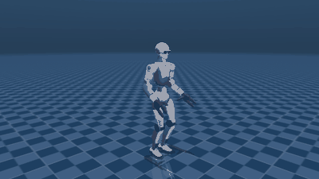

# R1 in MuJoCo

[← Tutorials](README.md)

The Unitree R1 humanoid in MuJoCo, run inside the gaitos node. Model: `unitree_mujoco` `r1`
(the model has three joints the URDF does not, held in place, and no head joints). Walking:
ZMP preview control of a LIPM with a DCM stabilizer and the torque feedforward of the ground
reaction (`gaitos_dynamics/LipmZmpController`).

| Walking (`locomotion_lipm`) | Body pose and squat |
|:---:|:---:|
|  |  |
| balance_stand → 0.15 m/s → 0.3 rad/s → stop | body 8 cm down, back up, squat |

## 1. Before starting

```bash
cd ~/ws/legged_ws
source install/setup.bash
export ROS_DOMAIN_ID=10
```

## 2. Launch

```bash
ros2 launch gaitos_mujoco sim.launch.py robot:=r1 [rviz:=true] [real_time_factor:=1.0]
```

The arguments are those of [Go2 in MuJoCo](go2_mujoco.md#2-launch). The R1 starts **standing,
in `stand_up`** (SRDF pose `stand`).

## 3. Modes

| Mode | Controller | What it does |
|---|---|---|
| `damp`, `zero_torque` | joint | passive joints |
| `stand_up`, `squat` | joint | SRDF poses `stand`, `squat` (Unitree R1 FSM 4 / 2) |
| `balance_stand` | stance | standing, the body follows `goal_pose`; a `cmd_vel` starts `locomotion_lipm` |
| `locomotion_lipm` | lipm | ZMP / LIPM walking (Unitree R1 FSM 811) |
| `locomotion` | gait | kinematic walking (configured, not verified on the R1) |

```bash
ros2 service call /r1/mode/balance_stand std_srvs/srv/Trigger
ros2 topic pub --once /r1/goal_pose geometry_msgs/msg/PoseStamped \
  "{header: {frame_id: pelvis_link}, pose: {position: {z: -0.08}, orientation: {w: 1.0}}}"   # 8 cm down
ros2 service call /r1/mode/squat std_srvs/srv/Trigger
ros2 service call /r1/mode/stand_up std_srvs/srv/Trigger
ros2 topic echo /r1/status
```

## 4. Walking

```bash
ros2 service call /r1/mode/balance_stand std_srvs/srv/Trigger
ros2 topic pub -r 10 /r1/cmd_vel geometry_msgs/msg/Twist "{linear: {x: 0.15}}"   # forward
ros2 topic pub -r 10 /r1/cmd_vel geometry_msgs/msg/Twist "{angular: {z: 0.3}}"   # turn in place
```

Stopping (no `cmd_vel` for `idle_time`) ends with the feet together. Limits: forward up to
0.15 m/s and turning; faster or lateral walking falls.

## 5. unitree_r1 against this simulation

The DDS interface of the R1 (`/lowstate`, `/odommodestate`, the loco service `/api/sport` with
its FSM, `/api/arm`) in front of gaitos, for the `unitree_r1` stack written for the real robot:

```bash
ros2 launch gaitos_unitree_sim sim.launch.py robot:=r1 simulator:=mujoco bringup:=true
ros2 service call /r1/r1_locomotion/stand std_srvs/srv/Trigger     # FSM 4  -> stand_up
ros2 service call /r1/r1_locomotion/walk std_srvs/srv/Trigger      # FSM 811 -> balance_stand
ros2 topic pub -r 10 /r1/cmd_vel geometry_msgs/msg/Twist "{linear: {x: 0.3}}"
```

`bringup:=true` starts `r1_core` of unitree_r1 (r1_state, robot_state_publisher, r1_locomotion,
r1_gesture) in `/r1`; the gaitos node is in `/gaitos`. unitree_r1 asks for at least 0.3 m/s, the
LIPM caps it at 0.15 m/s. `arm_sdk:=true` adds the arms (`arm_sdk`, FSM 816 while held) and
`dex3:=true` kinematic Dex3-1 hands, see [Vendor interfaces](../emulators.md).

## 6. The R1 with Dex3-1 hands

`gaitos_description` also has `mjcf/r1_dex3.xml` (with `mjcf/scene_dex3.xml`) and
`urdf/r1_dex3.urdf`: the Dex3-1 hands of the unitree_ros G1 URDF on
the R1 wrists, with their joints, masses (0.7 kg each) and meshes; the R1 wrist mesh is clipped
where the stock fist starts. The URDF has each hand as one rigid body, so the controllers of
gaitos know its weight. The finger joints are held where they start (`hold_gains`).

The model also has the colours of the stock R1: each visual mesh is cut into one mesh per
material (`mjcf/meshes_dex3`), by CAD part and by position on the part, and the collision geoms move
to group 3 (hidden). Visual only; the physics is the same.

```yaml
robot:
  urdf: package://gaitos_description/robots/r1_description/urdf/r1_dex3.urdf
hardware:
  model: package://gaitos_description/robots/r1_description/mjcf/scene_dex3.xml
```

With 1.4 kg more at the wrists the stance controller of `balance_stand` (a PD of the stand pose,
no balance feedback) tips the R1 over its toes; `locomotion_lipm` stands and walks with them.

## 7. Known issues

- `squat` → `stand_up` falls: the interpolation between the two postures tips the robot.
  Go through `balance_stand` or `damp` + `stand_up` with the robot held.

## 8. Remake the clips

```bash
docs/tools/record_mujoco.sh r1 docs/media/r1_mujoco_walk.gif 0 15 "--distance 2.3 --azimuth 135 --elevation -12" \
  --at 1 "mode balance_stand" --at 2 "vel 0.15 0 0" --at 9 "vel 0 0 0.3" --at 12.5 "stop"
docs/tools/record_mujoco.sh r1 docs/media/r1_mujoco_postures.gif 0 9.5 "--distance 2.2 --azimuth 120 --elevation -10" \
  --at 1 "mode balance_stand" --at 2 "pose 0 0 -0.08 0 0 0" --at 4.5 "pose 0 0 0 0 0 0" --at 6 "mode squat"
```
